[English](README.md) · [简体中文](README.zh-CN.md) · [繁體中文](README.zh-TW.md) · [日本語](README.ja.md) · [한국어](README.ko.md) · **Español**

# skill-gallery

Mira lo que hacen realmente los skills de diseño web para agentes: los mismos prompts, construidos por Claude Code y Codex, con y sin cada skill, lado a lado.

[](LICENSE)
[](https://heweitianqing.github.io/skill-gallery/es/)

[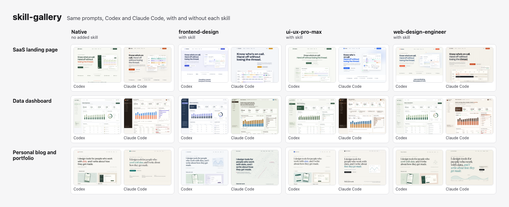](https://heweitianqing.github.io/skill-gallery/es/)

<!-- status:start -->
> **Estado: v0.** Ya se han ejecutado las 24 celdas (2026-10-25 – 2026-10-26, UTC).
<!-- status:end -->

## Por qué

Hay muchos skills para agentes (el formato `SKILL.md`) que prometen un trabajo de front-end más vistoso. Es difícil saber qué cambian de verdad. Sus README muestran ejemplos escogidos a mano, y a menudo no está claro cómo instalar e invocar el mismo skill en Claude Code y en Codex. Este repositorio ejecuta cada skill con los mismos prompts y en las mismas condiciones, muestra todos los resultados y documenta los pasos exactos de instalación e invocación para ambos agentes.

## Cómo funciona la comparación

Cada prompt se ejecuta en cuatro celdas:

|  | Nativo (sin skill añadido) | + skill |
| --- | --- | --- |
| **Codex** | `codex__native` | `codex__<skill>` |
| **Claude Code** | `claude__native` | `claude__<skill>` |

Las dos celdas nativas dependen solo del prompt, así que cada skill se compara con las mismas dos referencias.

| Agente | Modelo | Effort |
| --- | --- | --- |
| Codex CLI | `gpt-6.1-sol` | `model_reasoning_effort=high` |
| Claude Code | `claude-opus-5-5` | `--effort high` |

Tres prompts, solo páginas web. Usan una redacción neutra, sin adjetivos de estilo, y las cuatro celdas reciben exactamente el mismo texto; las celdas con skill solo añaden una frase final que nombra el skill.

| Prompt | Qué pide |
| --- | --- |
| [`landing-saas`](prompts/landing-saas.md) | Una página de marketing para una herramienta ficticia de planificación de guardias, con selector de precios y preguntas frecuentes |
| [`dashboard`](prompts/dashboard.md) | Un panel de ventas y operaciones para una empresa ficticia de tostado de café, a partir de datos fijos |
| [`blog-portfolio`](prompts/blog-portfolio.md) | Un portafolio y blog de una sola página para una diseñadora de producto ficticia |

## Resultados

<!-- results:start -->
Cada cuadro muestra la parte superior de la página en ancho de escritorio: Codex arriba y Claude Code abajo. Haz clic en una miniatura para abrir ese resultado en la galería.

<table>
<thead><tr><th>Prompt</th><th>Nativo (sin skill añadido)</th><th><a href="https://heweitianqing.github.io/skill-gallery/es/skills/frontend-design/">frontend-design</a></th><th><a href="https://heweitianqing.github.io/skill-gallery/es/skills/ui-ux-pro-max/">ui-ux-pro-max</a></th><th><a href="https://heweitianqing.github.io/skill-gallery/es/skills/web-design-engineer/">web-design-engineer</a></th></tr></thead>
<tbody>
<tr><th><a href="https://heweitianqing.github.io/skill-gallery/es/prompts/landing-saas/">Landing page de SaaS</a></th><td align="center"><a href="https://heweitianqing.github.io/skill-gallery/es/cells/landing-saas/codex__native/"></a><br><sub>Codex</sub><br><a href="https://heweitianqing.github.io/skill-gallery/es/cells/landing-saas/claude__native/"></a><br><sub>Claude Code</sub></td><td align="center"><a href="https://heweitianqing.github.io/skill-gallery/es/cells/landing-saas/codex__frontend-design/">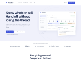</a><br><sub>Codex</sub><br><a href="https://heweitianqing.github.io/skill-gallery/es/cells/landing-saas/claude__frontend-design/"></a><br><sub>Claude Code</sub></td><td align="center"><a href="https://heweitianqing.github.io/skill-gallery/es/cells/landing-saas/codex__ui-ux-pro-max/"></a><br><sub>Codex</sub><br><a href="https://heweitianqing.github.io/skill-gallery/es/cells/landing-saas/claude__ui-ux-pro-max/">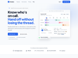</a><br><sub>Claude Code</sub></td><td align="center"><a href="https://heweitianqing.github.io/skill-gallery/es/cells/landing-saas/codex__web-design-engineer/"></a><br><sub>Codex</sub><br><a href="https://heweitianqing.github.io/skill-gallery/es/cells/landing-saas/claude__web-design-engineer/">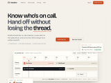</a><br><sub>Claude Code</sub></td></tr>
<tr><th><a href="https://heweitianqing.github.io/skill-gallery/es/prompts/dashboard/">Panel de datos</a></th><td align="center"><a href="https://heweitianqing.github.io/skill-gallery/es/cells/dashboard/codex__native/"></a><br><sub>Codex</sub><br><a href="https://heweitianqing.github.io/skill-gallery/es/cells/dashboard/claude__native/"></a><br><sub>Claude Code</sub></td><td align="center"><a href="https://heweitianqing.github.io/skill-gallery/es/cells/dashboard/codex__frontend-design/"></a><br><sub>Codex</sub><br><a href="https://heweitianqing.github.io/skill-gallery/es/cells/dashboard/claude__frontend-design/">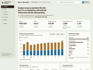</a><br><sub>Claude Code</sub></td><td align="center"><a href="https://heweitianqing.github.io/skill-gallery/es/cells/dashboard/codex__ui-ux-pro-max/"></a><br><sub>Codex</sub><br><a href="https://heweitianqing.github.io/skill-gallery/es/cells/dashboard/claude__ui-ux-pro-max/">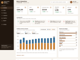</a><br><sub>Claude Code</sub></td><td align="center"><a href="https://heweitianqing.github.io/skill-gallery/es/cells/dashboard/codex__web-design-engineer/">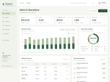</a><br><sub>Codex</sub><br><a href="https://heweitianqing.github.io/skill-gallery/es/cells/dashboard/claude__web-design-engineer/">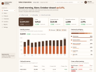</a><br><sub>Claude Code</sub></td></tr>
<tr><th><a href="https://heweitianqing.github.io/skill-gallery/es/prompts/blog-portfolio/">Blog y portafolio personal</a></th><td align="center"><a href="https://heweitianqing.github.io/skill-gallery/es/cells/blog-portfolio/codex__native/">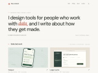</a><br><sub>Codex</sub><br><a href="https://heweitianqing.github.io/skill-gallery/es/cells/blog-portfolio/claude__native/">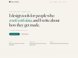</a><br><sub>Claude Code</sub></td><td align="center"><a href="https://heweitianqing.github.io/skill-gallery/es/cells/blog-portfolio/codex__frontend-design/"></a><br><sub>Codex</sub><br><a href="https://heweitianqing.github.io/skill-gallery/es/cells/blog-portfolio/claude__frontend-design/">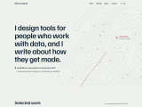</a><br><sub>Claude Code</sub></td><td align="center"><a href="https://heweitianqing.github.io/skill-gallery/es/cells/blog-portfolio/codex__ui-ux-pro-max/">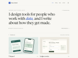</a><br><sub>Codex</sub><br><a href="https://heweitianqing.github.io/skill-gallery/es/cells/blog-portfolio/claude__ui-ux-pro-max/"></a><br><sub>Claude Code</sub></td><td align="center"><a href="https://heweitianqing.github.io/skill-gallery/es/cells/blog-portfolio/codex__web-design-engineer/"></a><br><sub>Codex</sub><br><a href="https://heweitianqing.github.io/skill-gallery/es/cells/blog-portfolio/claude__web-design-engineer/">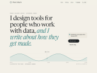</a><br><sub>Claude Code</sub></td></tr>
</tbody>
</table>
<!-- results:end -->

## Skills: instalación y uso

La versión corta para cada agente. Cada página de skill de la galería tiene los comandos completos y las notas.

<!-- skills:start -->
| Skill | Claude Code | Codex |
| --- | --- | --- |
| [frontend-design](https://heweitianqing.github.io/skill-gallery/es/skills/frontend-design/#install) | Copia la carpeta en `.claude/skills/frontend-design/`, luego termina el prompt con `Use the frontend-design skill.` (o escribe `/frontend-design …`) | Copia la carpeta en `.agents/skills/frontend-design/`, luego menciona `$frontend-design` en el prompt |
| [ui-ux-pro-max](https://heweitianqing.github.io/skill-gallery/es/skills/ui-ux-pro-max/#install) | Ejecuta `npx ui-ux-pro-max-cli@2.15.0 init --ai claude`, luego termina el prompt con `Use the ui-ux-pro-max skill.` (o escribe `/ui-ux-pro-max …`) | Ejecuta `npx ui-ux-pro-max-cli@2.15.0 init --ai codex`, luego menciona `$ui-ux-pro-max` en el prompt |
| [web-design-engineer](https://heweitianqing.github.io/skill-gallery/es/skills/web-design-engineer/#install) | Copia la carpeta en `.claude/skills/web-design-engineer/`, luego termina el prompt con `Use the web-design-engineer skill.` (o escribe `/web-design-engineer …`) | Copia la carpeta en `.agents/skills/web-design-engineer/`, luego menciona `$web-design-engineer` en el prompt |
<!-- skills:end -->

## Método y limitaciones

- **Aislamiento.** Cada ejecución empieza en un directorio desechable nuevo, fuera del repositorio, con un `HOME` vacío, su propio directorio de configuración (`CLAUDE_CONFIG_DIR` o `CODEX_HOME`) y un entorno construido desde cero. No se carga ninguna configuración, plugin, skill de nivel de usuario, servidor MCP ni memoria del operador. El skill se copia solo en la carpeta de skills de ese proyecto. Los registros de los propios agentes se guardan como evidencia en cada `run.json`.
- **El skill tiene que activarse.** Una celda con skill solo cuenta si sus registros muestran que el skill se cargó (`skill_triggered`). Si no, se marca como fallida. Consulta [docs/canary.md](docs/canary.md) para ver la prueba canario en la que se basa esta comprobación.
- **Una sola muestra por celda, sin elegir los mejores resultados.** Cada celda se genera una sola vez, sin turnos de seguimiento. Se publican todos los resultados, incluidos los fallos; al volver a ejecutar una celda se conserva el intento anterior.
- **Nativo significa tal como viene, no sin ningún skill.** Todas las celdas, también las nativas, pueden usar los skills que trae su agente: los 19 skills integrados en Claude Code y los skills de sistema de Codex (`imagegen`, `openai-docs`, `skill-creator`, `skill-installer`). En el prompt `dashboard`, el skill integrado `dataviz` de Claude Code se activó por sí solo dos veces, una en `claude__native` y otra en `claude__frontend-design`; `run.json` lo registra en `builtin_skills_used`. Es intencionado: se compara lo que obtiene en la práctica quien instala el agente.
- **Limitación: el resto del disco sigue siendo legible.** El aislamiento significa que no se *carga* nada, no que no se pueda *leer* nada. El sandbox `workspace-write` predeterminado de Codex puede leer `/`, y Claude Code con `bypassPermissions` no tiene sandbox. En las ejecuciones de v0, los agentes buscaron `AGENTS.md` en directorios superiores, y uno usó Playwright desde la caché de npm del operador para probar su página. Una cuenta de usuario aparte o un contenedor cerraría esta brecha.
- **Limitación: barras laterales fijas en las capturas.** Las capturas de página completa dibujan los elementos `position: fixed` o `sticky` con altura `100vh` solo a la altura de la primera pantalla, así que la barra lateral de un panel puede parecer que termina a los 900 px. La página en sí está bien; ábrela en la galería para comprobarlo.
- **Limitación: una sola muestra no es un benchmark.** Toma la galería como ejemplos de lo que un skill tiende a hacer, no como una puntuación.

Detalles: [docs/running.md](docs/running.md) y [docs/run-schema.md](docs/run-schema.md).

## Reproducir

Requisitos: macOS o Linux, Node 20+, git, la CLI de Codex y la CLI de Claude Code, con una sesión iniciada en cada una.

```bash
git clone https://github.com/heweitianqing/skill-gallery.git
cd skill-gallery
npm install
npx playwright install --no-shell chromium
codex login
bash scripts/setup-claude-auth.sh        # token de larga duración para las ejecuciones aisladas de Claude

node scripts/fetch-skill.mjs --all       # skills en sus versiones fijadas, en .cache/skills/
node scripts/run-codex.mjs landing-saas native
node scripts/run-codex.mjs landing-saas frontend-design
node scripts/run-claude.mjs landing-saas frontend-design
node scripts/screenshot.mjs              # desktop.png y mobile.png para las celdas nuevas

node scripts/build-site.mjs              # galería en site/dist/
node scripts/build-readme.mjs            # actualiza las tablas de todos los README
```

Para previsualizar la galería: `python3 -m http.server 8000 --directory site/dist` y luego abre <http://localhost:8000/>.

## Añadir un skill

Propón uno con el [formulario de sugerencia de skills](https://github.com/heweitianqing/skill-gallery/issues/new?template=skill-suggestion.yml) o añádelo tú mismo:

1. Crea `skills/<name>/meta.yaml` con el origen fijado (repositorio, commit, ruta), la licencia y cómo instalarlo e invocarlo en cada agente. Copia uno existente como plantilla.
2. Ejecuta `node scripts/fetch-skill.mjs <name>`, luego las seis celdas del skill (tres prompts × dos agentes) y `node scripts/screenshot.mjs`.
3. Añade el nombre del skill a `site/config.json` y ejecuta `node scripts/build-readme.mjs`.
4. Abre una pull request con las nuevas celdas de `runs/`. No vuelvas a ejecutar celdas para conseguir un resultado más bonito.

Consulta [CONTRIBUTING.md](CONTRIBUTING.md) para más detalles.

## Créditos

Los skills pertenecen a sus autores y conservan sus propias licencias. Este repositorio no incluye sus archivos; se descargan en el commit o la versión fijados.

<!-- credits:start -->
| Skill | Origen | Licencia | Commit fijado |
| --- | --- | --- | --- |
| [frontend-design](https://heweitianqing.github.io/skill-gallery/es/skills/frontend-design/) | [anthropics/skills](https://github.com/anthropics/skills) `skills/frontend-design` | [Apache-2.0](https://github.com/anthropics/skills/blob/dbd4588f9e1033efb41dad4bef2f7947c8993d44/skills/frontend-design/LICENSE.txt) | [`dbd4588f9e`](https://github.com/anthropics/skills/tree/dbd4588f9e1033efb41dad4bef2f7947c8993d44/skills/frontend-design) |
| [ui-ux-pro-max](https://heweitianqing.github.io/skill-gallery/es/skills/ui-ux-pro-max/) | [nextlevelbuilder/ui-ux-pro-max-skill](https://github.com/nextlevelbuilder/ui-ux-pro-max-skill) `.claude/skills/ui-ux-pro-max`<br><sub>Copyright (c) 2024 Next Level Builder</sub> | [MIT](https://github.com/nextlevelbuilder/ui-ux-pro-max-skill/blob/d14efff8ed1faa4187f004f79926f428c8074ec7/LICENSE) | `ui-ux-pro-max-cli@2.15.0` (generado por la CLI)<br><sub>[`d14efff8ed`](https://github.com/nextlevelbuilder/ui-ux-pro-max-skill/tree/d14efff8ed1faa4187f004f79926f428c8074ec7/.claude/skills/ui-ux-pro-max)</sub> |
| [web-design-engineer](https://heweitianqing.github.io/skill-gallery/es/skills/web-design-engineer/) | [ConardLi/garden-skills](https://github.com/ConardLi/garden-skills) `skills/web-design-engineer`<br><sub>Copyright (c) 2026 (no name given; attribute to ConardLi/garden-skills)</sub> | [MIT](https://github.com/ConardLi/garden-skills/blob/2b9a89340b70f632d31c0f1c69fce94a7912423e/LICENSE) | [`2b9a89340b`](https://github.com/ConardLi/garden-skills/tree/2b9a89340b70f632d31c0f1c69fce94a7912423e/skills/web-design-engineer) |
<!-- credits:end -->

## Aviso legal

Este proyecto no está afiliado a Anthropic ni a OpenAI, ni cuenta con su respaldo o patrocinio. Claude, Claude Code, Codex y otros nombres son marcas comerciales de sus respectivos propietarios. Las páginas de `runs/` son salidas de los modelos sin editar, y las empresas y personas ficticias que aparecen en ellas son inventadas.

Las traducciones de este README y de la galería se hicieron con IA. Las correcciones son bienvenidas como pull requests.

El código y la documentación de este repositorio se publican bajo la [licencia MIT](LICENSE).
